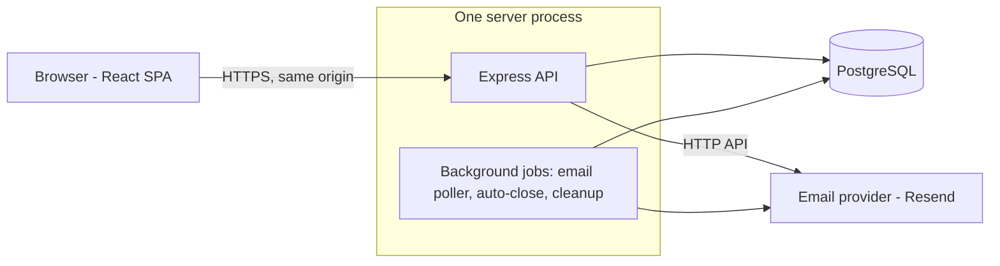
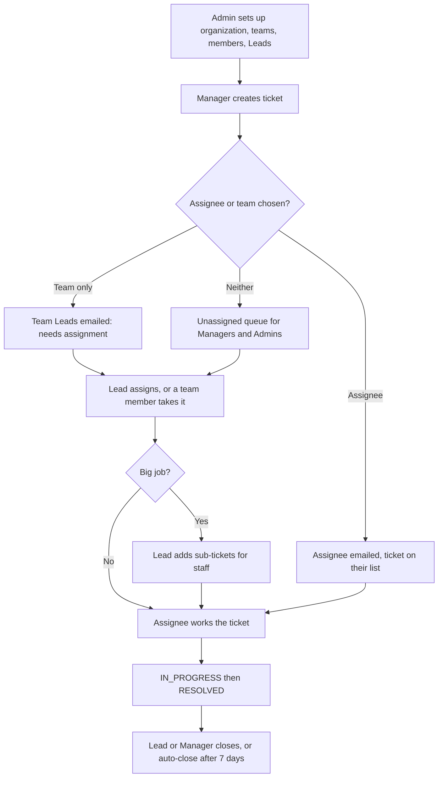
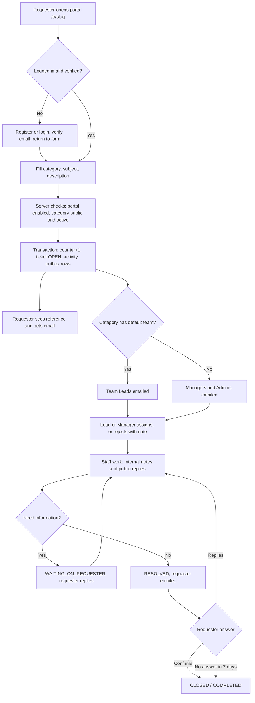
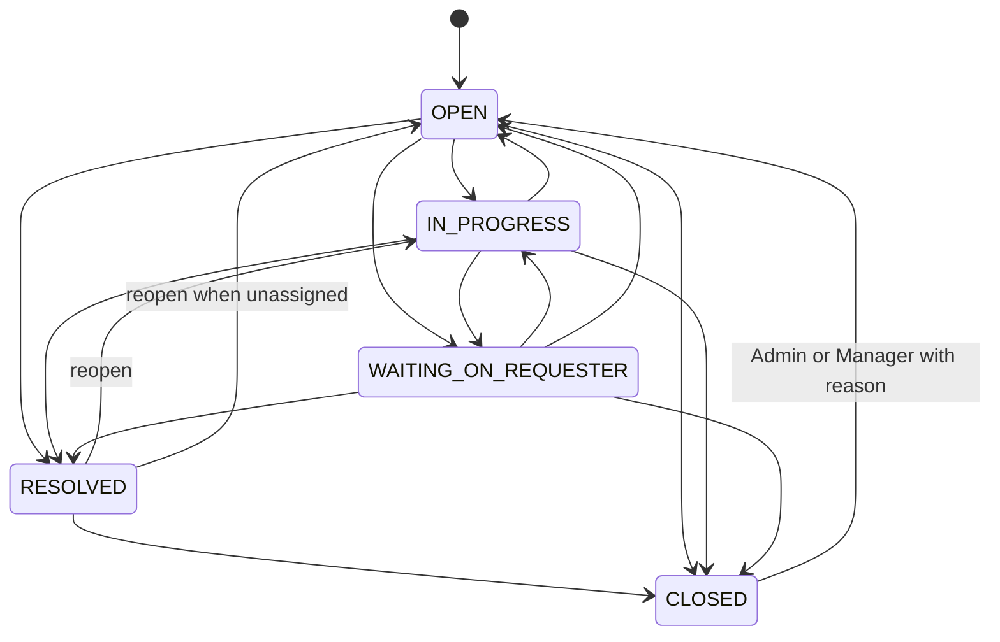
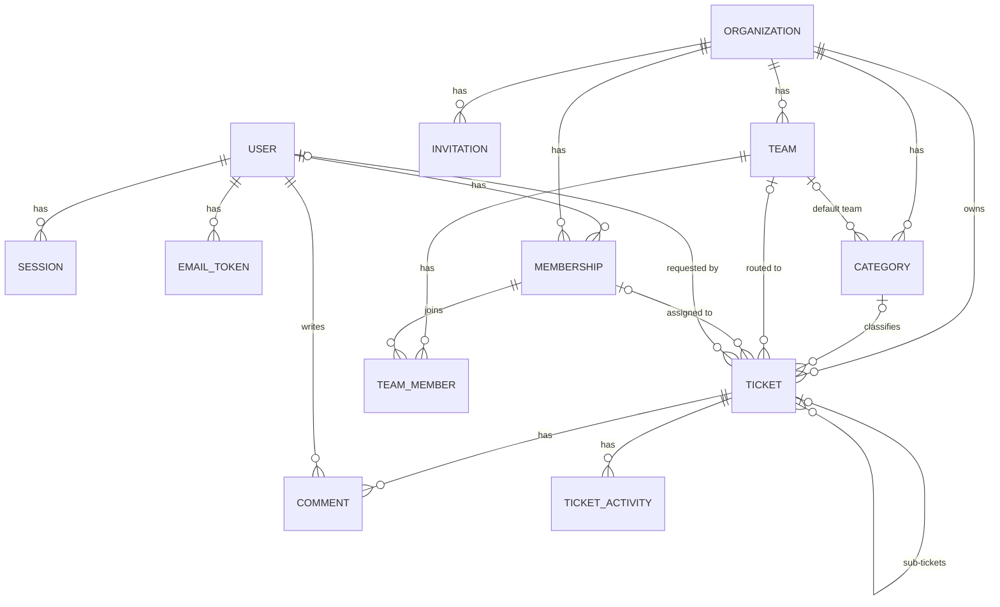
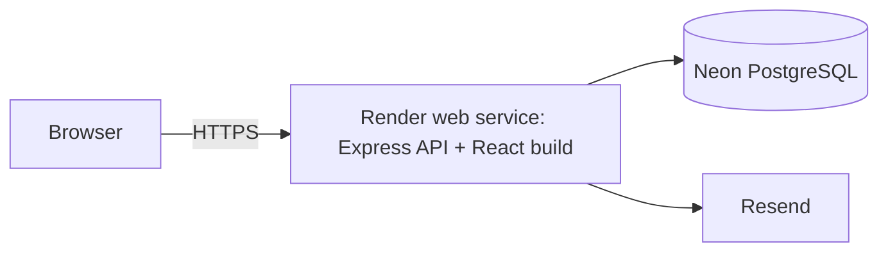
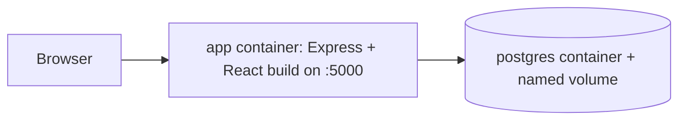

# Architecture - Complaint and Ticket Management Portal

This document explains **how** the system is built. Product rules live in
[`README.md`](README.md) (what and why); the order of work lives in
[`planning.md`](planning.md) (when). Diagrams use Mermaid, which GitHub renders
automatically.

## Table of contents

1. [System overview](#1-system-overview)
2. [Architecture style and layering](#2-architecture-style-and-layering)
3. [Backend modules](#3-backend-modules)
4. [Request pipeline](#4-request-pipeline)
5. [Multi-tenancy and authorization](#5-multi-tenancy-and-authorization)
6. [The two flows as diagrams](#6-the-two-flows-as-diagrams)
7. [Ticket state machine and transactions](#7-ticket-state-machine-and-transactions)
8. [Data model](#8-data-model)
9. [API design](#9-api-design)
10. [Authentication internals](#10-authentication-internals)
11. [Email outbox and background jobs](#11-email-outbox-and-background-jobs)
12. [Frontend architecture](#12-frontend-architecture)
13. [Security checklist](#13-security-checklist)
14. [Logging and health](#14-logging-and-health)
15. [Deployment and Docker](#15-deployment-and-docker)
16. [Testing architecture](#16-testing-architecture)
17. [Trade-offs and known limitations](#17-trade-offs-and-known-limitations)

---

## 1. System overview

One Express application serves the JSON API (`/api/v1/*`) and, in production,
the built React app. A small set of background jobs runs **inside the same
process**. There is one PostgreSQL database and one email provider.



Development and production differ only in who serves the SPA:

| | Development | Production |
| --- | --- | --- |
| SPA | Vite dev server `:5173` | Built files served by Express |
| API | Express `:5000` | Same Express |
| Same origin? | Yes - Vite proxies `/api` to `:5000` | Yes - one service |
| Email | `console` transport (prints link in terminal) | Resend |
| Database | Local PostgreSQL (`ctp_dev`, `ctp_test`) | Neon PostgreSQL |

Same origin means **no CORS and first-party cookies** in every environment.

## 2. Architecture style and layering

A **modular monolith**: one deployable, split into feature modules, each with
the same small layering:

```text
route (URL + middleware chain)
  -> controller   parse/validate request (Zod), call service, send response
  -> service      business rules, permission checks, transactions
  -> repository   Prisma queries - ALWAYS scoped by organizationId
  -> mapper       turn DB rows into explicit response objects (DTOs)
```

Rules that keep it simple:

- Plain functions and modules; no base classes, no dependency-injection
  framework.
- Business rules live in **services** and in pure functions under `shared/`
  (permissions, visibility, status machine) that are easy to unit-test.
- Controllers stay thin; repositories contain no business rules.
- A feature folder is created only when the feature is built.

## 3. Backend modules

| Module | Responsibility |
| --- | --- |
| `auth` | Register, verify email, login/logout, forgot/reset password, sessions, `me`. |
| `orgs` | Create organization, settings, portal toggle, my organizations. |
| `members` | Member list, role change, soft remove, offboarding rules, last-Admin rule. |
| `invitations` | Create, resend, revoke, accept. |
| `teams` | Teams, team members, Lead flag, archive. |
| `categories` | Categories, public flag, default team, archive. |
| `tickets` | Create (internal), list/search/filter, detail, edit, status machine, assignment, sub-tickets, activity. |
| `comments` | Public replies and internal notes. |
| `portal` | Public portal info; complaint submission (login required). |
| `requester` | "My complaints": list, detail, reply, confirm, withdraw. |
| `dashboard` | Permission-scoped counts. |
| `notifications` | Outbox model, templates, email transports, poller. |
| `jobs` | Auto-close and cleanup schedulers. |
| `shared` | Errors, permissions, visibility, ticket filters, crypto helpers, constants. |

## 4. Request pipeline

Every request passes the same ordered steps; each step has one job.

```text
1  request id + Pino logger (redacted)
2  Helmet (security headers) + JSON body limit (100 kB)
3  Origin check for POST/PATCH/PUT/DELETE
4  Rate limiter (only on selected routes)
5  Session middleware       -> req.user (or none)
6  requireAuth / requireVerified      (route-specific)
7  requireOrgMember(:slug)  -> req.org + req.actor   (workspace routes only)
8  Zod validation of params, query, body
9  controller -> service -> repository (transaction where needed)
10 mapper (explicit fields only) -> JSON response
   any thrown AppError -> central error handler -> standard error shape
```

## 5. Multi-tenancy and authorization

Isolation is enforced in **four layers** (no composite foreign keys needed):

1. **Membership middleware.** All workspace routes are `/orgs/:slug/...`.
   `requireOrgMember` resolves the slug, loads the **active** membership for
   `(user, org)`, and builds an `actor`. Not a member -> `404`.
2. **Org-scoped repositories.** Every function takes `organizationId`. There
   are no "find by id only" helpers for organization data.

   ```ts
   // never:  prisma.ticket.findUnique({ where: { id } })
   // always: prisma.ticket.findFirst({ where: { id, organizationId } })
   ```
3. **Reference checks in services.** Any id from the client (team, category,
   assignee, parent ticket) is loaded with `organizationId` before use; a
   foreign or missing id is rejected.
4. **Tests.** Each module ships cross-organization tests; Phase 10 adds a suite
   that calls every workspace endpoint as a member of another organization.

Cross-tenant and "not visible" both return **404** so existence is not leaked.

### The actor

```ts
type Actor = {
  userId: string;
  organizationId: string;
  membershipId: string;
  role: 'ADMIN' | 'MANAGER' | 'STAFF';
  teamIds: string[];      // teams the member belongs to
  leadTeamIds: string[];  // subset where isLead = true
};
```

### Permissions and visibility are pure functions

```ts
// shared/permissions.ts  (no database access - unit-tested per matrix row)
can(actor, 'ticket.assign', { ticket, targetAssignee });
can(actor, 'ticket.changeStatus', { ticket, from, to });
can(actor, 'ticket.close', { ticket });

// shared/visibility.ts  (one rule, used by list, detail, comments, dashboard)
function buildTicketVisibilityWhere(actor: Actor): Prisma.TicketWhereInput {
  const base = { organizationId: actor.organizationId };
  if (actor.role !== 'STAFF') return base;               // ADMIN, MANAGER
  return {
    ...base,
    OR: [
      { assigneeId: actor.membershipId },
      { createdByMembershipId: actor.membershipId },
      { teamId: { in: actor.teamIds } },
    ],
  };
}
```

`allowedActions` for the UI (`canAssign`, `allowedStatuses`, `canClose`, ...)
are computed with the same functions, so the UI can never offer an action the
server would refuse. The server still re-checks on every mutation.

## 6. The two flows as diagrams

### Flow A - top-down



### Flow B - bottom-up



### Where they meet

A complaint (Flow B ticket) can be split by a Lead into **internal
sub-tickets** (Flow A mechanics). The requester endpoints return only the
parent and its public comments.

## 7. Ticket state machine and transactions



The table with allowed actors and preconditions is README section 7.3. It is
implemented as **data** in `tickets/status-machine.ts`:

```ts
// { from, to, actors: ['ASSIGNEE','LEAD','MANAGER_PLUS','REQUESTER','SYSTEM'], requires?: [...] }
```

One function, `applyTransition(...)`, checks the table, the actor, and the
preconditions (assignee present, requester present, sub-tickets done, close
reason), then performs the update with a conditional `WHERE status = <from>`.

### Operations that must be one database transaction

| Operation | Rows written together |
| --- | --- |
| Create organization | organization + Admin membership |
| Create ticket (either flow) | counter increment + ticket + `CREATED` activity + outbox rows |
| Create sub-ticket | counter + ticket + activity on child and parent + outbox rows |
| Status change | ticket update + activity + outbox rows (+ timestamps) |
| Assignment | ticket update + activity + outbox row |
| Requester reply | comment + optional status change + activity + outbox rows |
| Remove member | membership status + team memberships removed + unassignments + activity |
| Auto-close (per ticket) | conditional ticket update + activity + outbox row |

Email is **never** sent inside a transaction; only the outbox row is.

## 8. Data model

IDs are UUIDs; timestamps are UTC `timestamptz`. Every organization-owned
table has `organizationId` (including child tables) so every query can filter
by it.



### Enums

```text
MembershipRole      ADMIN | MANAGER | STAFF
MembershipStatus    ACTIVE | REMOVED
EmailTokenType      VERIFY_EMAIL | RESET_PASSWORD
TicketSource        INTERNAL | PORTAL
TicketStatus        OPEN | IN_PROGRESS | WAITING_ON_REQUESTER | RESOLVED | CLOSED
TicketPriority      LOW | MEDIUM | HIGH | URGENT
CloseReason         COMPLETED | REJECTED | CANCELLED
CommentVisibility   PUBLIC | INTERNAL
CommentAuthorType   STAFF | REQUESTER
ActivityType        CREATED | STATUS_CHANGED | ASSIGNED | UNASSIGNED | TEAM_CHANGED |
                    PRIORITY_CHANGED | DUE_DATE_CHANGED | CATEGORY_CHANGED | EDITED |
                    SUBTICKET_ADDED
NotificationType    NEEDS_ASSIGNMENT | ASSIGNED_TO_YOU | COMPLAINT_RECEIVED | STAFF_REPLIED |
                    REQUESTER_REPLIED | WAITING_ON_YOU | RESOLVED | CLOSED
NotificationStatus  PENDING | SENDING | SENT | FAILED
```

### Entities

| Entity | Key fields | Constraints / notes |
| --- | --- | --- |
| **User** | id, email, name, passwordHash, emailVerifiedAt, createdAt, updatedAt | `UNIQUE(email)` (normalized). |
| **Session** | id, userId, tokenHash, expiresAt, lastUsedAt, revokedAt, userAgent, createdAt | `UNIQUE(tokenHash)`; index `userId`. |
| **EmailToken** | id, userId, type, tokenHash, expiresAt, usedAt, createdAt | `UNIQUE(tokenHash)`. Verify (24 h) and reset (1 h). |
| **Organization** | id, name, slug, portalEnabled, portalIntro, ticketCounter, createdAt, updatedAt | `UNIQUE(slug)`. |
| **Membership** | id, organizationId, userId, role, status, createdAt, removedAt | `UNIQUE(organizationId, userId)`. Never hard-deleted. |
| **Invitation** | id, organizationId, email, role, tokenHash, invitedByMembershipId, expiresAt, acceptedAt, revokedAt, createdAt | `UNIQUE(tokenHash)`; one pending per (org, email) enforced in the service. |
| **Team** | id, organizationId, name, nameKey, description, archivedAt, createdAt | `UNIQUE(organizationId, nameKey)` (`nameKey` = trimmed lowercase name). |
| **TeamMember** | id, organizationId, teamId, membershipId, isLead | `UNIQUE(teamId, membershipId)`. |
| **Category** | id, organizationId, name, nameKey, isPublic, defaultTeamId, archivedAt | `UNIQUE(organizationId, nameKey)`. |
| **Ticket** | id, organizationId, number, source, subject, description, status, priority, closeReason, closeNote, categoryId, teamId, assigneeId (membership), requesterId (user), createdByMembershipId, parentId, dueDate, createdAt, updatedAt, resolvedAt, closedAt | `UNIQUE(organizationId, number)`. CHECK: `PORTAL` tickets have `requesterId`; sub-tickets have no `requesterId`; `closeReason` set iff `CLOSED`. |
| **Comment** | id, organizationId, ticketId, authorUserId, authorType, visibility, body, createdAt | CHECK: `REQUESTER` authors are always `PUBLIC`. Immutable. |
| **TicketActivity** | id, organizationId, ticketId, actorUserId (null = system), type, fromValue, toValue, note, createdAt | Append-only. |
| **Notification** | id, organizationId, toEmail, type, payload (JSON ids only), status, attempts, nextAttemptAt, lastError, sentAt, createdAt | Outbox. Payload never contains tokens. |

### Indexes (add with the table, justified by real queries)

- `Ticket(organizationId, status)`, `(organizationId, assigneeId)`,
  `(organizationId, teamId)`, `(organizationId, requesterId)`,
  `(organizationId, parentId)`, `(organizationId, updatedAt)`.
- `Comment(ticketId, createdAt)`, `TicketActivity(ticketId, createdAt)`.
- `Membership(userId, status)`, `TeamMember(membershipId)`.
- `Notification(status, nextAttemptAt)`.

Teams, categories, and memberships are archived or soft-removed rather than
deleted because history references them.

## 9. API design

- Base path `/api/v1`; JSON only; Zod validation on params, query, and body.
- Workspace routes: `/orgs/:slug/...`; tickets are addressed by number.
- Pagination `?page=1&pageSize=25` (max 100); response includes `total`.
- Sorting from an allow-list: `?sort=updatedAt&order=desc`.
- Filters (list): status, priority, category, team, assignee, source,
  unassigned, overdue, mine; search by `T-number` or subject.
- Status codes: `200/201` success, `400` validation, `401` not logged in,
  `403` logged in but not allowed (inside an organization you belong to),
  `404` not found **or** not visible / not yours, `409` conflict or invalid
  transition or duplicate, `422` business-rule violation, `429` rate limited,
  `500` unexpected.

Error shape (always):

```json
{
  "error": {
    "code": "VALIDATION_ERROR",
    "message": "Some fields are invalid.",
    "fields": { "subject": "Subject is required." },
    "requestId": "req_8f2c..."
  }
}
```

Error codes used: `VALIDATION_ERROR`, `UNAUTHENTICATED`, `EMAIL_NOT_VERIFIED`,
`FORBIDDEN`, `NOT_FOUND`, `CONFLICT`, `INVALID_TRANSITION`,
`ASSIGNEE_NOT_ELIGIBLE`, `OPEN_SUBTICKETS`, `LAST_ADMIN`, `ALREADY_MEMBER`,
`RATE_LIMITED`, `INTERNAL_ERROR`.

### Endpoints

| Area | Endpoints |
| --- | --- |
| Health | `GET /health` (includes DB check) |
| Auth | `POST /auth/register`, `/auth/verify-email`, `/auth/resend-verification`, `/auth/login`, `/auth/logout`, `/auth/forgot-password`, `/auth/reset-password`; `GET /auth/me` |
| Organizations | `POST /orgs`; `GET /me/orgs`; `GET/PATCH /orgs/:slug` |
| Members | `GET /orgs/:slug/members`; `PATCH /orgs/:slug/members/:membershipId` (role); `DELETE .../members/:membershipId` (soft remove) |
| Invitations | `GET/POST /orgs/:slug/invitations`; `POST .../invitations/:id/resend`; `DELETE .../invitations/:id`; `POST /invitations/accept` |
| Teams | `GET/POST /orgs/:slug/teams`; `PATCH .../teams/:id` (rename/archive); `PUT/DELETE .../teams/:id/members/:membershipId` (PUT body: `isLead`) |
| Categories | `GET/POST /orgs/:slug/categories`; `PATCH .../categories/:id` |
| Tickets | `GET/POST /orgs/:slug/tickets`; `GET/PATCH .../tickets/:number`; `POST .../tickets/:number/status`; `POST .../tickets/:number/assignment`; `POST .../tickets/:number/subtickets`; `GET .../tickets/:number/activity` |
| Comments | `GET/POST /orgs/:slug/tickets/:number/comments` |
| Dashboard | `GET /orgs/:slug/dashboard` |
| Portal | `GET /public/portals/:slug` (no login); `POST /portals/:slug/complaints` (login + verified) |
| Requester | `GET /me/tickets`; `GET /me/tickets/:orgSlug/:number`; `POST .../comments`; `POST .../confirm`; `POST .../withdraw` |

Portal (public) response contains only: organization name, slug, intro,
accepting-complaints flag, and active public categories (`id`, `name`).

Requester ticket response contains only: reference, subject, description,
status, category name, timestamps, **public** comments (staff shown as first
name + organization name; requester as "You"), and allowed actions. Never:
assignee email, team internals, internal notes, activity, sub-tickets, other
tickets.

Ticket detail for members includes `allowedActions`, `parent` summary,
`subtickets` summary (number, subject, status, assignee name), and the
progress count.

## 10. Authentication internals

**Opaque server-side sessions** (not JWT):

- On login, generate 32 random bytes (base64url) -> cookie `sid`; store only the
  **SHA-256 hash** with `expiresAt = now + 7 days`.
- Cookie flags: `HttpOnly; SameSite=Lax; Path=/; Secure` in production.
- Each request: hash cookie -> find session -> check not revoked and not
  expired -> load user. `expiresAt` slides forward (updated at most once an
  hour).
- New session on every login (prevents session fixation). Logout revokes the
  session. Password reset revokes **all** the user's sessions.
- Membership is checked per request, so removing a member takes effect
  immediately without touching sessions.

| Token | Lifetime | Stored as | Notes |
| --- | --- | --- | --- |
| Session | 7 days sliding | SHA-256 hash | Multi-use |
| Email verification | 24 h | SHA-256 hash | Single use |
| Password reset | 1 h | SHA-256 hash | Single use; revokes sessions |
| Invitation | 7 days | SHA-256 hash | Single use |

Links carry tokens in the **URL fragment** (`/verify-email#token=...`). The SPA
reads the fragment, removes it from the address bar, and sends it in a `POST`
body, so tokens do not reach server logs or `Referer` headers.

Other controls:

- Passwords: Argon2id; 8-128 characters; never logged or returned.
- **Origin check:** every non-GET request must carry an `Origin` header equal to
  `APP_ORIGIN`. Combined with `SameSite=Lax` and JSON-only bodies this is the
  CSRF defense. (Tests and Postman must send the header.)
- Generic responses for register, login failure, forgot-password.

### Rate limits (in-memory store; fine for one instance)

| Route | Limit |
| --- | --- |
| Login | 10 / 15 min per IP; 5 failures / 15 min per IP + email |
| Register | 10 / hour per IP |
| Resend verification | 3 / hour per account |
| Forgot password | 5 / hour per IP; 3 / hour per email |
| Portal complaint submit | 10 / hour per user |
| Invitation create | 30 / day per organization |

`TRUST_PROXY` must equal the number of proxies in front of the server, or every
request looks like it comes from the proxy IP.

## 11. Email outbox and background jobs

### Outbox (ticket emails)

1. The service inserts a `Notification` row (`PENDING`) **inside the same
   transaction** as the change. The payload holds ids only (ticket id, comment
   id, recipient), never secrets.
2. The poller runs every 15 s: select due `PENDING` rows (limit 20), claim each
   with a conditional update `PENDING -> SENDING`, render the email **from
   current database state**, and send through the transport.
3. Success -> `SENT` and `sentAt`. Failure -> `attempts + 1`, retry after
   1 min, then 5 min, then 30 min; after 3 failures -> `FAILED` with
   `lastError` and a log line.
4. Rows stuck in `SENDING` for more than 10 minutes go back to `PENDING`.

This assumes **one server instance**. Running several would need
`FOR UPDATE SKIP LOCKED`; documented as a later change.

### Account emails

Verify, reset, and invitation emails are sent **directly** after the token row
is committed (they contain a one-time token, so it is not stored in the
outbox). If sending fails, the action still succeeded and the user can press
*Resend*.

### Transports

`EMAIL_TRANSPORT=console` prints the full email (including links) to the
server terminal; `resend` uses the Resend HTTP API. A small interface
`sendEmail({ to, subject, text, html })` hides the difference. Header values
have CR/LF stripped.

### Jobs (started in `server.ts` only when `JOBS_ENABLED=true`)

| Job | Interval | Action |
| --- | --- | --- |
| Email poller | 15 s | Send due notifications. |
| Auto-close | 15 min | Close tickets `RESOLVED` for more than 7 days: per-ticket transaction with conditional update, activity, outbox row. |
| Cleanup | daily | Delete expired sessions/tokens; delete sent notifications older than 90 days. |

Jobs use database time and are safe to run twice. They stop cleanly on
`SIGTERM`.

## 12. Frontend architecture

### Routes

| Area | Routes |
| --- | --- |
| Public | `/login`, `/register`, `/verify-email#token=`, `/forgot-password`, `/reset-password#token=`, `/invite#token=` |
| Portal | `/o/:slug` (info + categories), `/o/:slug/submit` (login required) |
| My complaints | `/my/complaints`, `/my/complaints/:orgSlug/:number` |
| Onboarding | `/orgs/new` |
| Workspace | `/w/:slug` (dashboard), `/w/:slug/tickets`, `/w/:slug/tickets/new`, `/w/:slug/tickets/:number`, `/w/:slug/teams`, `/w/:slug/categories`, `/w/:slug/members`, `/w/:slug/settings` |

### Structure and conventions

- `features/<name>/` holds that feature's pages, components, API hooks, and
  Zod schemas.
- **Server state:** TanStack Query (query keys include the organization slug).
  **Forms:** React Hook Form + Zod. Local component state for everything else.
- **Route guards:** `RequireAuth` (session via `GET /auth/me`),
  `RequireVerified`, `RequireOrg` (finds the membership for `:slug` in
  `GET /me/orgs`, otherwise shows a Not Found page). Navigation items depend on
  role; the server still decides.
- After login, `returnTo` brings the user back to where they were (including
  the portal submit form).
- The API wrapper uses `credentials: 'include'`, parses the standard error
  shape, maps `fields` onto form fields, and redirects to login on `401`.
- Filters, sort, search, and page live in the **URL query string** (shareable,
  back-button safe) and are always applied on the server.
- Every screen has loading, empty, error, and success states.
- All user text is rendered as text; `dangerouslySetInnerHTML` is not used.
- Responsive down to phone width (portal, My complaints, ticket list, detail).

## 13. Security checklist

- [ ] Every route has: auth, membership (if workspace), permission check,
      validation, DTO mapper.
- [ ] No `organizationId`, `role`, `source`, `status`, `requesterId`, or
      `createdBy` taken from the client body.
- [ ] Cross-tenant and not-visible return `404`.
- [ ] Internal notes excluded **in the query** for requester endpoints and
      emails.
- [ ] Tokens and sessions stored only as SHA-256 hashes; tokens never logged.
- [ ] Cookies `HttpOnly`, `SameSite=Lax`, `Secure` in production.
- [ ] Origin check on every non-GET route.
- [ ] Helmet headers incl. CSP with no inline scripts; `Referrer-Policy:
      no-referrer` on token pages.
- [ ] Rate limits on auth, portal submit, and invitations.
- [ ] Generic responses on register, login, forgot-password.
- [ ] Logs redact password, token, cookie, authorization, complaint and comment
      bodies.
- [ ] Error responses contain no stack traces or SQL.
- [ ] `npm audit` reviewed before release; lockfiles committed.
- [ ] Seed script refuses to run in production.

## 14. Logging and health

- Pino JSON logs with a request id on every line; redaction list from Phase 0.
  Logs record ids, not content.
- `GET /api/v1/health` returns app status and a database check (`SELECT 1`).
- Graceful shutdown: stop accepting requests, stop jobs, close the Prisma
  connection.

## 15. Deployment and Docker

### Production (Phase 11) - one service



- In production Express serves `client/dist` and falls back to `index.html` for
  non-`/api` routes (SPA routing).
- Build: install, `prisma generate`, build client, build server.
  Start: `prisma migrate deploy && node dist/server.js`.
- Environment: `NODE_ENV=production`, `APP_ORIGIN=<public URL>`,
  `TRUST_PROXY=1`, `DATABASE_URL` (Neon), `EMAIL_TRANSPORT=resend`,
  `RESEND_API_KEY`, `EMAIL_FROM`, `JOBS_ENABLED=true`.
- Backups: Neon point-in-time recovery; test a restore once.

### Docker and CI (Phase 12, last)

Added only after the product works locally and in production.



- One multi-stage `Dockerfile`: build client -> build server -> slim runtime
  image, non-root user, health check on `/api/v1/health`,
  `prisma migrate deploy` on start.
- `docker-compose.yml`: `postgres` (named volume, health check) and `app`
  (starts after Postgres is healthy; environment from `.env`).
- `.dockerignore` excludes `node_modules`, `dist`, `.env`.
- GitHub Actions: format check, lint, typecheck, tests (Postgres service),
  build on every push and pull request.

## 16. Testing architecture

- **Layers:** pure unit tests (permissions, status machine, visibility,
  eligibility) -> service/API integration tests (Supertest + real PostgreSQL)
  -> manual journeys.
- **Test database:** `TEST_DATABASE_URL`; migrations applied once; tables
  truncated between test files; `JOBS_ENABLED=false`.
- **Factories:** `createUser`, `createOrg`, `createMember(role, teams)`,
  `createTeam`, `createCategory`, `createTicket`.
- **HTTP helper:** Supertest agent that keeps cookies and always sends the
  `Origin` header.
- **Email:** the transport is replaced with an in-memory spy; tests assert
  recipients and that internal notes never appear in requester emails.
- **Time:** auto-close and expiry tests set timestamps directly in the database
  instead of waiting.

## 17. Trade-offs and known limitations

| Choice | Benefit | Cost (accepted) |
| --- | --- | --- |
| Login required to complain | Simple, secure, no spam machinery | Anonymous complaints impossible in the MVP |
| Sessions in the database | Instant revocation | One extra query per request (indexed) |
| In-process jobs and in-memory rate limits | No extra infrastructure | One instance only; free tier sleep pauses jobs |
| No optimistic-lock version | Less UI plumbing | Last write wins on non-status fields (all changes are logged) |
| One-level sub-tickets | Easy to reason about | No deep hierarchies |
| Org isolation without composite foreign keys | Simple schema | Relies on service checks + tests (so the tests are mandatory) |
| English only, plain-text comments | Smaller scope, no XSS surface | No rich text, no translations |
