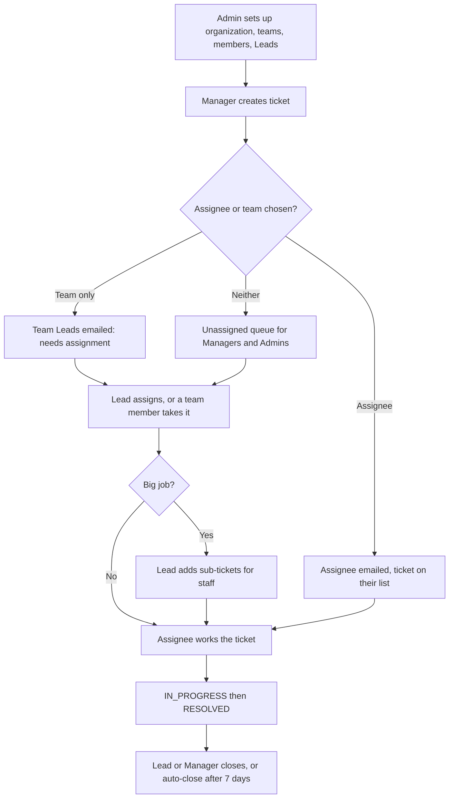
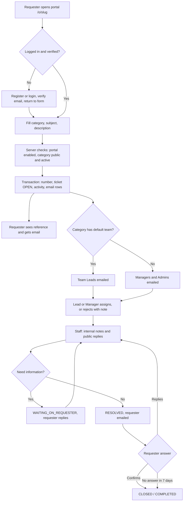
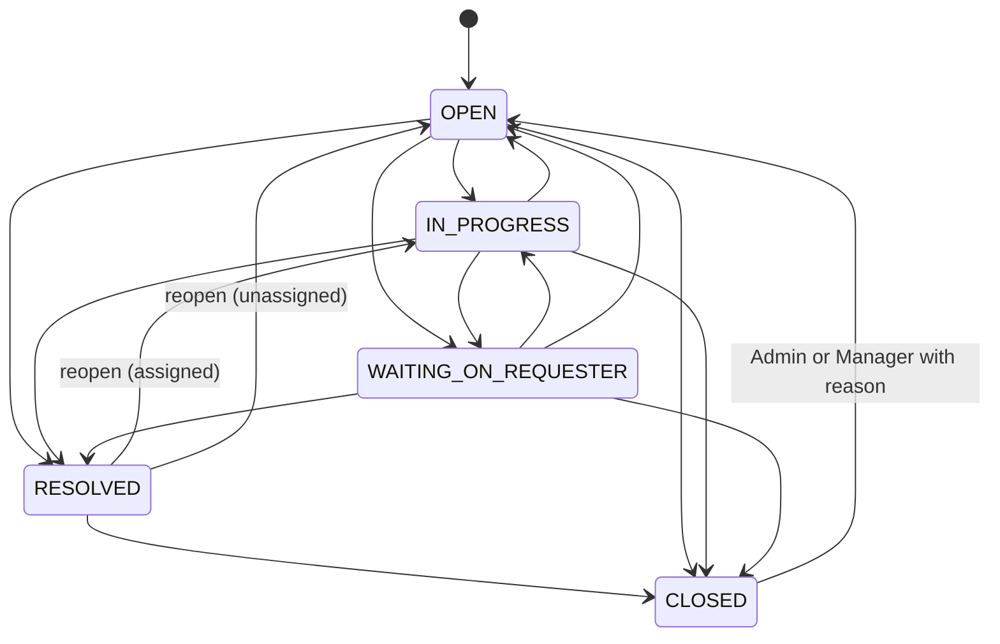
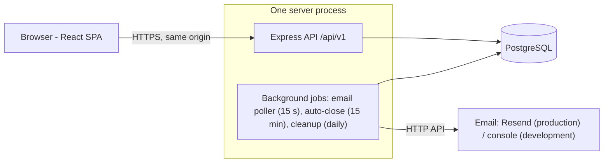
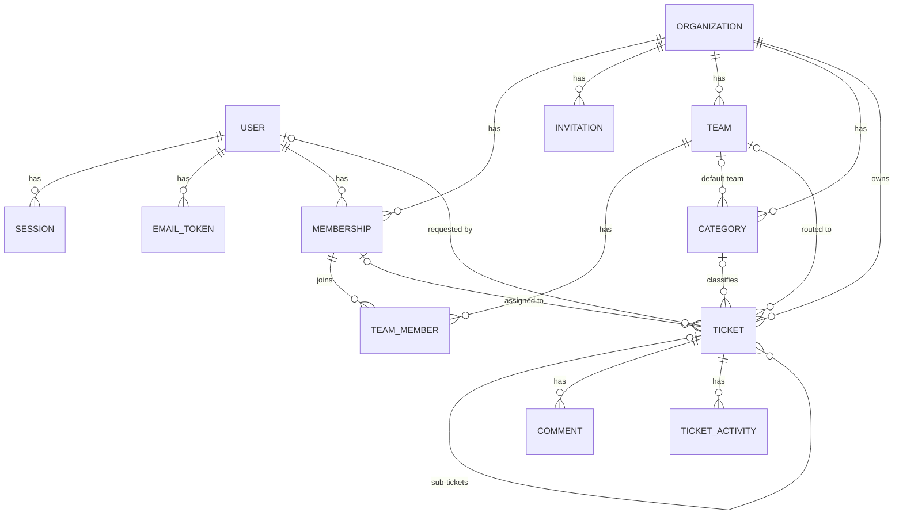

# Complaint and Ticket Management Portal - Complete Project Guide

> One document that explains the whole project: what it is, why it exists, how
> it works, how it is built, what tools it uses, where the main logic lives,
> what can be improved, and answers to the questions reviewers usually ask
> (technical and non-technical).
>
> Companion files: `README.md` (rules / specification), `architecture.md`
> (technical design), `planning.md` (phases and progress), `docs/demo-script.md`
> (demo steps), `docs/known-limitations.md`, and `demo.txt` (how to run, demo and test).

---

## Table of contents

1. [The project in one minute](#1-the-project-in-one-minute)
2. [The problem and why this project exists](#2-the-problem-and-why-this-project-exists)
3. [Similar products and what we borrowed](#3-similar-products-and-what-we-borrowed)
4. [The big idea: a fusion of two flows into one engine](#4-the-big-idea-a-fusion-of-two-flows-into-one-engine)
5. [Who uses it: roles and permissions](#5-who-uses-it-roles-and-permissions)
6. [Feature list](#6-feature-list)
7. [All the flows (how many and what they are)](#7-all-the-flows-how-many-and-what-they-are)
8. [The ticket lifecycle](#8-the-ticket-lifecycle)
9. [How a request travels through the system](#9-how-a-request-travels-through-the-system)
10. [Architecture](#10-architecture)
11. [Data model](#11-data-model)
12. [Technology and tools: what, why, and where they fit](#12-technology-and-tools-what-why-and-where-they-fit)
13. [Main logic: where it lives and what it does](#13-main-logic-where-it-lives-and-what-it-does)
14. [Security](#14-security)
15. [Testing and quality](#15-testing-and-quality)
16. [Project numbers](#16-project-numbers)
17. [Limitations (honest)](#17-limitations-honest)
18. [Future improvements and suggestions](#18-future-improvements-and-suggestions)
19. [Reviewer questions and answers](#19-reviewer-questions-and-answers)
20. [Glossary](#20-glossary)

---

## 1. The project in one minute

**What it is:** a web application where organizations (a college, a shop, a
company) handle **work and complaints in one place**.

**Two ways work comes in:**

- **Top-down (internal):** a manager creates a task ("Upgrade the lab PCs"),
  gives it to a team, and the team Lead can split it into smaller
  **sub-tickets** for individual staff.
- **Bottom-up (portal):** a customer or student opens the organization's public
  page (`/o/city-college`), logs in, and submits a complaint ("Wi-Fi is down in
  my room"). It is routed to the right team automatically.

Both become the **same kind of record - a ticket** - with one status flow, one
conversation, one activity history and one dashboard.

**Why it matters:** staff get one queue instead of an email inbox plus a task
tool; requesters get a reference number, email updates, and a page to follow
their complaint; managers get honest numbers.

**Multi-tenant:** many organizations share one app and one database, but each
organization's data is completely private to it (proven by automated tests).

---

## 2. The problem and why this project exists

| Today (without the portal) | With the portal |
| --- | --- |
| Complaints arrive by email, phone, WhatsApp, paper forms | One complaint page per organization, with categories |
| Nobody knows who is handling a complaint | Every ticket has a team and an assignee |
| Internal tasks live in another tool (or a spreadsheet) | Internal tasks and complaints share one engine |
| Big jobs are hard to split and track | Sub-tickets with a progress bar ("2 of 4 done") |
| The complainant never hears back | Reference number + emails at every important step |
| Staff notes and replies to the customer get mixed | **Internal notes** vs **public replies**, kept strictly separate |
| Managers cannot see the workload | Dashboard: open, unassigned, overdue, waiting, resolved |
| "Closed" complaints come back or are lost | Clear statuses, confirm-or-reopen, auto-close after 7 days |

**Goal of the project (final-year major project):** build a realistic,
secure, multi-organization system that a single developer can finish *well* -
with real rules, real security, and tests that prove it - instead of a large
but shallow demo.

---

## 3. Similar products and what we borrowed

| Similar product | What it is | What we borrowed | What we deliberately left out |
| --- | --- | --- | --- |
| **Jira** (Atlassian) | Project/task tracker | Tickets with assignee, priority, due date, one level of sub-tasks, status flow, "My work" | Boards, sprints, custom workflows, plugins |
| **Zendesk / Freshdesk** | Customer support desks | Organization portal, groups (our **Teams**) with agents, public reply vs internal note, solved -> closed with auto-close | SLAs, macros, phone/chat channels, anonymous tickets |
| **ServiceNow** (ITIL) | Enterprise IT service management | Category-based routing to a responsible group, triage queue | Full ITIL process modules |
| **College grievance portals / e-commerce complaint desks** | Simple complaint forms | Login to submit, reference number, track status, reply | Public complaint feeds, voting, ratings |

**What makes this project different:** most tools are either a *task tracker*
(top-down, like Jira) or a *help desk* (bottom-up, like Zendesk). This project
**fuses both into one ticket engine** (next section), sized for a college or
small business, with strict tenant isolation.

---

## 4. The big idea: a fusion of two flows into one engine

```text
 Internal ticket  (top -> down)          Portal complaint  (bottom -> up)
 Admin / Manager / Team Lead creates     A customer or student (logged in)
 a ticket and assigns it                 submits a complaint to an organization
               \                                   /
                v                                 v
              ONE TICKET ENGINE
   same table - same statuses - same assignment - same comments - same dashboard
                              |
     Manager / Lead triages, assigns, and can split work into sub-tickets
                              |
     Staff work it:   OPEN -> IN_PROGRESS -> RESOLVED -> CLOSED
```

**How the fusion works in practice**

- A ticket has a `source` field: `INTERNAL` (top-down) or `PORTAL` (bottom-up).
  That is the only difference at creation.
- After creation, **both use the same code**: the same status machine, the
  same assignment rules, the same comments, the same activity timeline, the
  same dashboard.
- **Where the flows meet:** a student's complaint (bottom-up) can be split by
  the team Lead into **internal sub-tickets** (top-down mechanics). The student
  only ever sees the parent complaint and public replies - never the
  sub-tickets, internal notes, or staff emails.

**Why one engine instead of two systems:** one lifecycle, one dashboard, half
the code, half the bugs, and the numbers always agree (decision D-01 in the
README).

---

## 5. Who uses it: roles and permissions

Roles are **per organization** (stored on the membership), so one person can be
Admin in org A, Staff in org B, and a requester in org C.

| Role | Who | Can do |
| --- | --- | --- |
| **Admin** | Organization owner(s) | Everything: settings, portal on/off, members, invitations, teams, categories, all tickets |
| **Manager** | Operations / supervisors | See **all** tickets, create, triage, assign anyone eligible, change team/priority, close, reopen closed |
| **Team Lead** | A Staff member flagged as Lead of a team | Manage **that team's** tickets: assign within the team, priority, due date, category, resolve, close, split into sub-tickets |
| **Staff** | Workers | See tickets of their teams + assigned to them + created by them; create tickets for their own team; **Take it** (self-assign); work tickets assigned to them |
| **Requester** | Any logged-in, verified user (student / customer) | Submit complaints; see **only their own**; reply; confirm "it's resolved"; withdraw while still open |

**Ticket visibility rule (one rule, written once):** a member can see a ticket
if they are Admin/Manager, **or** they are the assignee, **or** the ticket's
team is one of their teams, **or** they created it.

**Short permission matrix**

| Action | Admin | Manager | Lead | Staff |
| --- | :-: | :-: | :-: | :-: |
| Manage org, members, teams, categories, portal | Yes | - | - | - |
| Create internal ticket | any team | any team | own team | own team, self-assign only |
| Create sub-ticket | Yes | Yes | own team | - |
| Assign / reassign | anyone eligible | anyone eligible | team members | only "Take it" |
| Change team | Yes | Yes | - | - |
| Priority, due date, category | Yes | Yes | own team | - |
| Edit subject / description | Yes | Yes | - | - |
| Working status (start, wait, resolve) | Yes | Yes | own team | only as assignee |
| Close (with reason) | Yes | Yes | own team | - |
| Reopen a closed ticket | Yes | Yes | - | - |
| Comment | anyone who can see the ticket | | | |

---

## 6. Feature list

### Accounts and security
- Register, verify email (link valid 24 h), log in, log out, forgot / reset password (1 h link; resets log out every device).
- Passwords hashed with **Argon2id**; sessions are random tokens stored **only as SHA-256 hashes**; HttpOnly cookies.
- Generic answers ("if an account exists...") so nobody can test which emails are registered.
- Rate limits on login, register, resend, forgot password, invitations and complaint submission.
- "Return to where I was" after login, even across register -> verify email -> login.

### Organizations and people
- Create an organization (you become Admin); permanent URL slug (`/w/city-college`).
- Organization switcher (one user, many organizations, different roles).
- Invite by email + role (7-day single-use link); resend (new link) / revoke; accept only with the same verified email; re-invite reactivates a removed member.
- Change roles, remove members (soft remove: history keeps their name with "(removed)").
- **Last-Admin protection** (cannot demote/remove the last Admin, even with two Admins acting at the same moment).
- **Offboarding:** removing a member removes them from teams and unassigns their open tickets (logged as a system action).

### Teams and categories
- Teams with members and one or more **Leads**; rename; archive (with open-ticket count).
- Categories (public on the portal or internal-only) with a **default team** for automatic routing; archive.

### Tickets (the core)
- Create internal tickets (subject, description, priority, due date, category, team, assignee) with role limits.
- Reference numbers per organization (`T-1`, `T-2`, ...), unique even under concurrent creation.
- Ticket list with **queues** (All open, Unassigned, My tickets, My team), filters (status, priority, team, assignee, source, overdue, unassigned), search (`T-42` or subject words), sort and pagination - all in the URL (shareable).
- Ticket detail with only the buttons you are allowed to use (`allowedActions` from the server).
- Status workflow with a close dialog (reason + note) and a reopen dialog (reason required).
- Assignment, **Take it**, team change (clears an ineligible assignee), priority / due date / category edits.
- **Sub-tickets** (one level) with progress bar; the parent cannot be resolved or closed until all parts are done.
- **Activity timeline:** every change (who, from, to, when), merged with the conversation.

### Conversation and email
- Comments: **internal note** (default, amber) or **public reply** (green, only if the ticket has a requester). Plain text, immutable.
- Email notifications through an **outbox** with automatic retries: needs assignment, assigned to you, complaint received, staff replied, we need information, requester replied, resolved, closed.

### Portal and requester side
- Public portal page per organization (intro, categories, privacy note); "not available" / "not accepting complaints" states.
- Submit a complaint (login + verified), confirmation with reference.
- **My complaints:** list across all organizations, detail with the public conversation, reply, "Yes, it's resolved", withdraw (only before work starts), "submit a new complaint" on closed ones.

### Dashboard and automation
- Dashboard cards: Open workload, Unassigned, Overdue, Waiting on requester, Resolved (30 days), My work + breakdowns by status, priority, team. **Every card links to a list with exactly that many tickets.**
- **Auto-close:** resolved tickets close themselves after 7 days.
- **Cleanup:** expired sessions/tokens and old sent emails are deleted daily.

### Developer / demo extras
- Seed script with two demo organizations and accounts (`npm run seed`, refuses to run in production).
- Express serves the built React app in production (one URL, no CORS).

---

## 7. All the flows (how many and what they are)

There are **2 main business flows** (the fusion) and **5 end-to-end user
journeys** (A-E) that together cover every feature. Inside them are **12
supporting flows**.

### 7.1 The two main business flows

**Flow A - Top-down (internal tickets)**



**Flow B - Bottom-up (portal complaints)**



### 7.2 The five end-to-end journeys (used for acceptance and the demo)

| Journey | Name | What it proves |
| --- | --- | --- |
| **A** | Set up an organization | Register/verify/login, create org, teams, public category, portal on, invitations, Lead |
| **B** | Top-down with sub-tickets | Manager creates, Lead gets "needs assignment" email, splits into sub-tickets, parent waits for parts, close |
| **C** | Bottom-up complaint | Portal, login redirect, reference, routing by category, requester sees only their own |
| **D** | Communication and privacy | Internal note vs public reply (page and email), waiting -> reply -> back to work, other org gets 404 |
| **E** | Completion | Resolve -> confirm -> closed, reply blocked after close, auto-close after 7 days, reject spam with note |

All five were executed automatically against a live server: **33/33 checks passed**.

### 7.3 Supporting flows (12)

| # | Flow | Short description |
| --- | --- | --- |
| 1 | Registration and email verification | Generic response; verify link in `#fragment`; unverified users see a "verify your email" screen |
| 2 | Login / logout / session | New session per login, 7-day sliding expiry, logout revokes server-side |
| 3 | Forgot / reset password | 1-hour link; reset revokes all sessions |
| 4 | Organization creation | Org + Admin membership in one transaction; duplicate slug -> 409 |
| 5 | Invitation | Create -> email -> accept with same verified email; resend / revoke; reactivation |
| 6 | Member management and offboarding | Role change, soft remove, last-Admin rule, unassign open tickets |
| 7 | Team and category setup | Leads, default team routing, archive |
| 8 | Assignment and "Take it" | Eligibility check, conditional update, email to assignee |
| 9 | Sub-ticket split | One level, defaults from parent, parent waits |
| 10 | Requester reply side effects | Waiting -> back to work (or queue); resolved -> reopened; closed -> blocked |
| 11 | Email outbox | Saved in the same transaction, sent by the poller, retried, marked failed |
| 12 | Auto-close and cleanup jobs | 7-day close, daily cleanup |

---

## 8. The ticket lifecycle

### 8.1 Statuses

| Status | Meaning | Counts as open work |
| --- | --- | :-: |
| `OPEN` | Created; waiting for assignment or work | Yes |
| `IN_PROGRESS` | Someone is working on it (needs an assignee) | Yes |
| `WAITING_ON_REQUESTER` | Staff need information (only with a requester) | Yes |
| `RESOLVED` | Staff think it is done; requester can confirm or reply | - |
| `CLOSED` | Final, always with a reason: `COMPLETED`, `REJECTED` (note required), `CANCELLED` | - |

There is no "NEW" status: "triage" is simply the queue of unassigned `OPEN` tickets.

### 8.2 State diagram



### 8.3 Who may make each move

| From -> To | Allowed | Conditions |
| --- | --- | --- |
| OPEN -> IN_PROGRESS | Assignee, Lead, Manager+ | needs an assignee |
| OPEN / IN_PROGRESS -> WAITING | Assignee, Lead, Manager+ | needs a requester |
| IN_PROGRESS -> OPEN | Assignee, Lead, Manager+ | - |
| WAITING -> OPEN | Assignee, Lead, Manager+, **System** (requester replied, unassigned) | - |
| WAITING -> IN_PROGRESS | Assignee, Lead, Manager+, **System** (requester replied) | needs an assignee |
| OPEN / IN_PROGRESS / WAITING -> RESOLVED | Assignee, Lead, Manager+ | all sub-tickets done |
| RESOLVED -> IN_PROGRESS / OPEN (reopen) | Assignee, Lead, Manager+, **System** (requester replied) | IN_PROGRESS if assigned, else OPEN |
| RESOLVED -> CLOSED (completed) | Lead, Manager+, **Requester** (confirm), **System** (7 days) | sub-tickets done |
| OPEN / IN_PROGRESS / WAITING -> CLOSED | Lead, Manager+ | reason; REJECTED needs a note; sub-tickets done |
| OPEN -> CLOSED (cancelled) | **Requester** (withdraw) | only while OPEN |
| CLOSED -> OPEN | Admin, Manager | reason required |

Anything else -> `409 INVALID_TRANSITION`, nothing changes. This table lives in
**one file** (`status-machine.ts`) and is tested for all 125 combinations.

---

## 9. How a request travels through the system

Example: Staff Sam clicks **Start work** on ticket T-7.

```text
Browser (React)  POST /api/v1/orgs/city-college/tickets/7/status  { status: "IN_PROGRESS" }
  1  Request id + logger (secrets redacted)
  2  Helmet security headers, JSON body limit 100 kB
  3  Origin check (must come from our own site: CSRF protection)
  4  Session middleware: cookie -> SHA-256 -> sessions table -> req.user
  5  requireAuth: must be logged in
  6  requireOrgMember: slug -> organization -> Sam's ACTIVE membership -> req.actor
       (not a member -> 404, the same answer as "does not exist")
  7  Zod validation of the body
  8  Service: load T-7 THROUGH the visibility rule (not visible -> 404)
  9  Status machine: which roles does Sam play for T-7? (ASSIGNEE)
       Is OPEN -> IN_PROGRESS allowed for ASSIGNEE? Does it have an assignee? yes
 10  One database transaction:
       UPDATE tickets SET status='IN_PROGRESS' WHERE id=? AND status='OPEN'
       (0 rows -> someone changed it first -> 409, nothing saved)
       INSERT activity "Sam changed status from Open to In progress"
       INSERT email outbox rows if someone must be told
 11  Mapper builds the response (explicit fields + allowedActions)
 12  React puts the fresh ticket into its cache; the page updates
 Later: the email poller (every 15 s) sends any outbox rows.
```

---

## 10. Architecture

### 10.1 System overview



- **One deployable app** (a "modular monolith"): Express serves the JSON API and,
  in production, the built React app. Same origin = no CORS and first-party cookies.
- **Development:** Vite (`:5173`) serves React and forwards `/api` to Express (`:5000`).

### 10.2 Layers inside the server (every module looks the same)

```text
route       URL + middleware chain (auth, membership, rate limit)
controller  validate input with Zod, call the service, send JSON
service     business rules, permission checks, transactions
repository  Prisma queries - ALWAYS scoped by organizationId
mapper      database rows -> explicit response objects (DTOs)
shared/     pure functions: permissions, visibility, filters, crypto, errors
```

### 10.3 Server modules

| Module | Responsibility |
| --- | --- |
| `auth` | register, verify, login/logout, forgot/reset, `me` |
| `orgs` | create, my organizations, settings, portal toggle |
| `members` | list, change role, remove, offboarding |
| `invitations` | create, list, resend, revoke, accept |
| `teams` | teams, members, Lead flag, archive |
| `categories` | categories, public flag, default team, archive |
| `tickets` | create, list/search/filter, detail, edit, status machine, assignment, sub-tickets, activity |
| `comments` | internal notes and public replies |
| `portal` | public portal info, complaint submission |
| `requester` | My complaints: list, detail, reply, confirm, withdraw |
| `dashboard` | permission-scoped counts |
| `notifications` | outbox, email templates, poller |
| `jobs` | scheduler, auto-close, cleanup |

### 10.4 Multi-tenancy: four layers of isolation

1. **Membership middleware** - every workspace URL is `/orgs/:slug/...`; the
   caller's active membership is loaded on **every request**; not a member -> 404.
2. **Org-scoped queries** - every query includes `organizationId`; there is no
   "find by id only" for organization data.
3. **Reference checks** - every id from the client (team, category, assignee,
   parent ticket) is re-loaded *with the organization id* before use.
4. **Tests** - each module has cross-organization tests, plus an isolation
   suite that calls **all 28 workspace endpoints** from another organization
   and checks that nothing changed.

Cross-tenant, "does not exist" and "not visible to you" all return **404**, so
outsiders cannot even learn what exists.

### 10.5 Email outbox (reliable emails)

```text
Change happens  ->  same DB transaction writes  ticket + activity + notification row (PENDING)
Poller (15 s)   ->  claim row (PENDING -> SENDING) -> render email from current data -> send
                    success: SENT       failure: retry after 1 min, then 5 min, 3rd failure: FAILED
                    stuck in SENDING > 10 min (server crashed): back to PENDING
```

Why: if the email provider is down, the work is still saved and the email is
retried; if the change fails, no email is sent. Account emails (verify, reset,
invite) are sent immediately because they contain one-time tokens, which are
never stored in plain text.

### 10.6 Frontend structure

```text
client/src/
  app/router.tsx       all routes and route guards
  components/          shared UI (buttons, inputs, dialog, badges, loading/empty/error states)
  features/
    auth/              login, register, verify, forgot, reset, guards
    orgs/              onboarding, create org, workspace shell + switcher, settings, portal toggle
    members/           members page, accept invitation
    teams/ categories/ management pages
    tickets/           list (queues, filters), new ticket, detail (controls, sub-tickets, timeline, composer)
    portal/            public portal page, submit complaint
    my-complaints/     requester list and detail
    dashboard/         cards and breakdowns
  lib/                 API client (/api/v1 prefix, errors, 401 -> login), returnTo helper
```

Routes: public (`/login`, `/register`, `/verify-email`, `/invite`, ...),
portal (`/o/:slug`, `/o/:slug/submit`), requester (`/my/complaints/...`),
workspace (`/w/:slug`, `/tickets`, `/tickets/new`, `/tickets/:number`,
`/teams`, `/categories`, `/members`, `/settings`).

---

## 11. Data model

13 tables (UUID ids, UTC timestamps). Every organization-owned table has `organizationId`.



| Table | Key points |
| --- | --- |
| users | unique email (lowercased), Argon2id hash, `emailVerifiedAt` |
| sessions | only the SHA-256 hash of the cookie token; expiry, revoked |
| email_tokens | verify / reset tokens, hashed, single use |
| organizations | unique slug, `portalEnabled`, `ticketCounter` |
| memberships | user + org + role + status (ACTIVE / REMOVED), never deleted |
| invitations | hashed token, 7-day expiry, accepted / revoked |
| teams, team_members | `isLead` flag per team member; case-insensitive unique names |
| categories | `isPublic`, `defaultTeamId` |
| tickets | per-org `number`, source, status, priority, close reason/note, team, assignee, requester, parent |
| ticket_activities | append-only history (actor null = system) |
| comments | PUBLIC / INTERNAL, author type STAFF / REQUESTER, immutable |
| notifications | email outbox: status, attempts, next attempt, last error |

**Rules the database itself enforces (CHECK constraints):** portal tickets
always have a requester; sub-tickets never have a requester; a close reason
exists exactly when status is CLOSED; requester comments are always public.

---

## 12. Technology and tools: what, why, and where they fit

### 12.1 Stack

| Layer | Tool | What it does here | Why this choice |
| --- | --- | --- | --- |
| Language | **TypeScript** (strict) | Both client and server | Types catch mistakes before running; shared vocabulary |
| Frontend | **React 19 + Vite** | The single-page app; Vite is the fast dev server and bundler | Standard, fast, huge ecosystem |
| Routing | **React Router 7** | Pages and route guards (`RequireAuth`, `RequireVerified`) | De-facto standard |
| Server state | **TanStack Query** | Fetching, caching and refreshing API data | No hand-written loading/caching logic |
| UI | **Tailwind CSS 4 + shadcn/ui style components** | Styling, responsive layout | Fast to build, consistent, mobile-friendly |
| Icons | **lucide-react** | Icons | Light and consistent |
| Backend | **Node.js + Express** | HTTP API and serving the built app | Simple, well known, easy to reason about |
| Database | **PostgreSQL** | All data | Reliable, transactions, constraints, row locks |
| ORM | **Prisma 6** | Schema, migrations, typed queries | Type-safe queries; migrations in version control |
| Validation | **Zod** | Validates every request body/query; environment at start-up | One schema = validation + types |
| Passwords | **argon2** (Argon2id) | Password hashing | Current best practice, resistant to GPU cracking |
| Security headers | **Helmet** | CSP, no-referrer, HSTS, etc. | One line for many protections |
| Rate limiting | **express-rate-limit** | Login, register, reset, invites, complaints | Stops brute force and spam |
| Logging | **Pino + pino-http** | JSON logs with request ids, secrets redacted | Fast, structured, redaction built in |
| Email | **Resend** (prod), console (dev) | Sends emails over an HTTP API | Simple API, free tier; console needs no setup |
| Tests | **Vitest + Supertest** | Unit and API tests against a real test database | Fast; tests real SQL, not mocks |
| Quality | **ESLint + Prettier** | Lint rules and formatting | Consistent, catches common bugs |
| Hosting (Phase 11) | **Render + Neon** | Web service + managed PostgreSQL | Free tiers, simple setup |
| Containers / CI (Phase 12) | **Docker, Docker Compose, GitHub Actions** | One-command run; checks on every push | Added last on purpose |

### 12.2 Deliberately NOT used (and why)

| Not used | Why not |
| --- | --- |
| JWT tokens | Server sessions can be revoked instantly (logout, password reset) |
| Redis / queues (BullMQ) | The outbox table + in-process poller is enough for one server |
| WebSockets | Real-time updates are not needed for the MVP |
| Microservices | One app is simpler to build, test, deploy and explain |
| CAPTCHA / anonymous complaints | Verified login already blocks most spam |
| Optimistic-lock version columns | Conditional status updates + activity log are enough |

### 12.3 How the tools fit together

```text
React + Router + TanStack Query  --fetch /api/v1 (cookie)-->  Express
   Tailwind for the look                                       Helmet, rate limits, origin check, Pino
                                                               session -> membership -> Zod -> service
                                                               Prisma  --SQL-->  PostgreSQL
                                                               jobs: poller -> Resend / console
Vitest + Supertest test the Express app against a real test database.
ESLint + Prettier keep both codebases clean.
```

---

## 13. Main logic: where it lives and what it does

Only the most important pieces (paths are under `server/src/` or `client/src/`).

| Logic | File | In one sentence |
| --- | --- | --- |
| **Permission matrix** | `shared/permissions.ts` | Pure functions like `canAssign`, `canCloseTicket` - no database, unit-tested row by row |
| **Visibility rule** | `shared/visibility.ts` | `buildTicketVisibilityWhere(actor)` turns "who may see what" into a database filter used everywhere |
| **One filter builder** | `shared/ticket-filters.ts` | Same query parsing for the ticket list and the dashboard, so counts = lists |
| **Status machine** | `modules/tickets/status-machine.ts` | The transition table as data + `applyTransition` (checks, conditional update, activity) |
| **Ticket creation** | `modules/tickets/tickets.service.ts` | Role check -> reference checks -> transaction (number, ticket, activity, emails) |
| **Workflow** | `modules/tickets/tickets.workflow.ts` | Status, assignment, edits, sub-tickets, activity, offboarding unassign |
| **Atomic ticket number** | `modules/tickets/tickets.repository.ts` (`nextTicketNumber`) | `counter = counter + 1` inside the transaction; row lock = no duplicates |
| **Assignee eligibility** | `tickets.repository.ts` (`loadAssigneeCandidate`) | Active member of this org and in the ticket's team (or Manager/Admin) |
| **Membership guard** | `middleware/org-member.ts` | Slug -> org -> active membership -> `req.actor` (team ids, lead team ids) or 404 |
| **Sessions** | `middleware/session.ts`, `modules/auth/auth.service.ts` | Hash the cookie, look it up, slide expiry; reset revokes all |
| **Last-Admin rule** | `modules/members/members.service.ts` | Locks all Admin rows (`FOR UPDATE`) before counting |
| **Invitation accept** | `modules/invitations/invitations.service.ts` | Same email, conditional claim, reactivate removed members |
| **Portal submission** | `modules/portal/portal.service.ts` | Org only from the URL; category must be public + active; routes to default team |
| **Requester side** | `modules/requester/requester.service.ts` | Everything filtered by `requesterId = me`; public comments only, in the query |
| **Outbox recipients** | `modules/notifications/outbox.ts` | Who gets which email; never the person who caused it |
| **Email templates** | `modules/notifications/templates.ts` | Built from current data; never internal notes |
| **Poller** | `modules/notifications/poller.ts` | Claim, send, retry (1 / 5 min), FAILED, stuck-row recovery |
| **Dashboard** | `modules/dashboard/dashboard.service.ts` | Each card = a query string run through the list's own builder |
| **Auto-close / cleanup** | `jobs/auto-close.ts`, `jobs/cleanup.ts`, `jobs/scheduler.ts` | 7-day close via the status machine; daily housekeeping |
| **SPA serving** | `shared/serve-client.ts` | Production: static files + `index.html` fallback, never for `/api` |
| **UI permissions** | `client/.../tickets/components/ticket-controls.tsx` | Shows only buttons listed in `allowedActions` from the server |
| **Privacy-first composer** | `client/.../tickets/components/ticket-timeline.tsx` | Defaults to internal note; public reply visually distinct |
| **API client** | `client/src/lib/api.ts` | `/api/v1` prefix, cookies, error shape, 401 -> login with return path |

---

## 14. Security

| Threat | Protection |
| --- | --- |
| Seeing another organization's data | 4-layer isolation; 404 for everything foreign; isolation test suite |
| Stolen database | Passwords Argon2id; session/email/invite tokens stored only as SHA-256 hashes |
| Stolen cookie (XSS) | HttpOnly cookie (JavaScript cannot read it); no token in localStorage; text never rendered as HTML |
| CSRF (fake form from another site) | Origin check on every non-GET request + SameSite=Lax cookie + JSON-only bodies |
| Password guessing | Rate limits (5 failures per email+IP, 10 per IP per 15 min) |
| Finding out who has an account | Generic answers on register / login / forgot password |
| Tokens leaking through URLs | Email links carry the token in `#fragment` (never sent to servers); page removes it immediately |
| Secrets in logs | Redaction of cookies, Set-Cookie, passwords, tokens, complaint/comment text (tested) |
| Internal notes reaching requesters | Filtered in the database query for pages and emails (tested) |
| Spoofed fields | `organizationId`, role, source, status, requester, creator never taken from the request |
| Race conditions | Unique constraints, row locks, conditional updates, atomic counters |
| Errors leaking internals | Central error handler: no stack traces or SQL in responses |
| Misconfigured production | Server refuses to start with invalid env, or without real email in production |

---

## 15. Testing and quality

- **132 automated server tests in 15 files**, run against a real PostgreSQL test database.
- Every feature has: a success test, an invalid-input test, a permission-denied
  test, and a cross-organization test (must be 404 and change nothing).
- Highlights:
  - **Status machine:** all 125 (from, to, actor) combinations compared against an independent table.
  - **Permission matrix:** one test per row.
  - **Isolation suite:** 28 endpoints x 2 ways of attacking, plus a before/after snapshot.
  - **Concurrency:** parallel ticket creation (unique numbers), parallel status changes (one wins), last-Admin race, invitation double-accept.
  - **Transactions:** a database trigger forces a failure mid-transaction; nothing is saved.
  - **Emails:** recipients, retries with backoff, FAILED after 3, no internal notes in requester emails.
  - **Dashboard = list** for every role.
- **Live end-to-end run** of Journeys A-E: 33/33.
- Lint (ESLint), formatting (Prettier), typecheck, production builds: all pass.

---

## 16. Project numbers

| Item | Count |
| --- | --- |
| API endpoints | 47 |
| Database tables | 13 (6 migrations) |
| Server modules | 13 |
| Roles | 3 + Lead flag + requester |
| Ticket statuses / close reasons | 5 / 3 |
| Email notification types | 8 ticket emails + 4 account emails |
| Background jobs | 3 |
| Automated tests | 132 |
| End-to-end journey checks | 33 |
| Design decisions recorded | 21 (README decision log D-01 ... D-21) |

---

## 17. Limitations (honest)

- One server instance (in-memory rate limits, simple email claiming).
- Free hosting sleeps when idle: slow first request; jobs can run late.
- No attachments, rich text, real-time updates, SLA timers, exports, custom fields.
- Login required to complain (no anonymous complaints).
- English only; changing your account email is not supported.
- Sub-tickets are one level deep.
- `zod` audit warning (low real risk here; fix = zod 4 migration).
- Full list: `docs/known-limitations.md`.

---

## 18. Future improvements and suggestions

**Product**
1. **Attachments** (photos of the broken thing) with object storage and virus scanning.
2. **Anonymous complaints** via a magic link + CAPTCHA (for whistle-blowing cases).
3. **SLA timers and escalation** (e.g. urgent tickets must be answered in 4 hours).
4. **In-app notifications** and notification preferences (choose which emails you get).
5. **Real-time updates** (WebSockets) so the list refreshes by itself.
6. **Satisfaction rating** after closing ("How did we do?").
7. **Reports and exports** (CSV/PDF, monthly trends, time-to-resolve per team).
8. **Per-organization settings** (auto-close days, default priority, branding/logo).
9. **Canned replies / macros** for common answers.
10. **Inbound email**: reply to the notification email to add a comment.
11. **Custom fields and workflows** per organization.
12. **Multi-language** interface (e.g. Hindi, Marathi).
13. **Mobile app** or installable PWA.
14. **AI assistance with human review**: suggest category/team, detect duplicates, summarize long threads.
15. **Audit-log screen** and a platform super-admin.

**Technical**
1. Run several server instances: shared rate-limit store (Redis), `FOR UPDATE SKIP LOCKED` for the email poller.
2. Migrate to zod 4 (clears the audit warning).
3. Browser end-to-end tests (Playwright) and visual checks at phone width.
4. OpenAPI documentation generated from the Zod schemas.
5. Monitoring and alerts (error tracking, uptime, failed-email alerts).
6. Full-text search in PostgreSQL for subjects and descriptions.
7. Database backups with a tested restore (Neon point-in-time recovery).
8. Optimistic locking for field edits if "last write wins" becomes a problem.

---

## 19. Reviewer questions and answers

### 19.1 Non-technical questions

**Q: What does this project do, in simple words?**
It is one place where an organization receives complaints from its customers
or students *and* manages its own internal tasks. Every item gets a number, an
owner, a status, a conversation, and a history, and the person who complained
can follow it online and by email.

**Q: Who would use it?**
Colleges (hostel, IT, accounts complaints), shops (delivery, refund
complaints), companies (internal IT/HR tasks and requests). Admins set it up,
managers and team leads distribute work, staff do the work, and students or
customers submit and follow complaints.

**Q: What problem does it solve that email or WhatsApp does not?**
Nothing gets lost: every complaint has an owner and a status, managers can see
what is waiting and what is overdue, the customer gets a reference number and
updates, and private staff discussion is kept separate from replies to the
customer.

**Q: What are the "two flows" and why combine them?**
Top-down (a manager creates work for a team) and bottom-up (a customer raises
a complaint). Real organizations have both. Combining them means one list, one
set of rules, and one dashboard, and a big complaint can be split into
internal tasks.

**Q: How is it different from Jira or Zendesk?**
Jira is mainly for internal tasks, Zendesk mainly for customer support. This
project does both in one simple engine, is designed for colleges and small
organizations, and keeps every organization's data separate.

**Q: Can one organization see another organization's complaints?**
No. Every request checks membership and every database query is limited to the
organization. Automated tests attack all 28 workspace endpoints from another
organization and confirm the answer is always "not found" with nothing changed.

**Q: Can a student see staff's private notes?**
No. Notes are marked internal, and the student's pages and emails only load
public replies, directly in the database query.

**Q: What if nobody answers a resolved complaint?**
The requester gets an email asking them to confirm or reply. If they do neither
within 7 days, the ticket closes automatically.

**Q: How do you stop spam complaints?**
A verified email account is required, there is a limit of 10 complaints per
hour per user, and staff can close spam as "Rejected" with a note.

**Q: What happens when an employee leaves?**
The Admin removes them: they lose access immediately, are taken out of their
teams, and their open tickets become unassigned (recorded in the history) so
someone else can pick them up. Their past work and name stay in the history.

**Q: Is it finished?**
All features are built and tested locally (Phases 0-10). Deployment to a
public URL and Docker/CI are the final steps.

### 19.2 Technical questions

**Q: Why a monolith and not microservices?**
One developer, one deployable app: simpler to build, test, deploy and reason
about. It is a *modular* monolith (clear modules with the same layering), so a
module could be split out later if ever needed.

**Q: Why server-side sessions instead of JWT?**
Sessions can be revoked instantly (logout, password reset, stolen cookie). JWTs
are valid until they expire unless you add a blacklist, which brings back
server state anyway. The cost is one indexed query per request.

**Q: How do you store passwords and tokens?**
Passwords with Argon2id (memory-hard). Session, verification, reset and
invitation tokens are 32 random bytes; only their SHA-256 hash is stored, so a
database leak does not give usable tokens.

**Q: How is multi-tenancy implemented without separate databases?**
Shared tables with `organizationId` on every organization-owned row, plus four
layers: membership middleware, org-scoped queries, re-checking every client id
against the organization, and isolation tests. Foreign or invisible resources
return 404.

**Q: How do you make sure two tickets never get the same number?**
`UPDATE organizations SET ticketCounter = ticketCounter + 1 RETURNING ...`
inside the same transaction as the insert. The row lock serializes concurrent
creations, and a rollback also rolls back the counter. A test creates 10
tickets in parallel and gets 1..10. `MAX(number)+1` would have a race.

**Q: What if two people change the status at the same time?**
The update is conditional: `WHERE id = ? AND status = <expected>`. The second
one updates zero rows and gets `409`, and the UI reloads. Assignment uses the
same idea with the previous assignee.

**Q: Where are the business rules, and how do you avoid duplicating them in the UI?**
In pure functions (`permissions.ts`, `status-machine.ts`, `visibility.ts`).
The server also uses them to compute `allowedActions` in the ticket response,
and the UI only shows those buttons. The server still re-checks every action.

**Q: How do you guarantee dashboard numbers match the lists?**
Each dashboard card is a query string run through the same Zod schema and the
same `buildTicketWhere` (visibility + filters) as the list. The card links to
that exact query. A test compares every card against the list total for every
role.

**Q: Why an outbox for emails?**
So email and data cannot disagree: the email row is written in the same
transaction as the change, and sending happens later with retries. A down
provider never undoes a change, and a rolled-back change never sends an email.
Delivery is at-least-once.

**Q: Why not use a queue like Redis/BullMQ?**
The volume is small and there is one server instance. A table plus a 15-second
poller is simpler and has no extra infrastructure. The documented upgrade path
is `FOR UPDATE SKIP LOCKED` or a real queue.

**Q: How do you prevent CSRF?**
The Origin header must equal our own origin on every non-GET request, the
cookie is `SameSite=Lax`, and bodies are JSON only.

**Q: How do you prevent XSS?**
All user text is rendered as text (React escapes it; no `dangerouslySetInnerHTML`),
comments are plain text, Helmet sets a Content-Security-Policy, and the
session cookie is HttpOnly.

**Q: How do you handle validation?**
Zod schemas on every body and query. Unknown fields are dropped, which is why a
client cannot set `status` or `organizationId`. Errors come back in one shape
with field messages that the forms show next to the inputs.

**Q: Why 404 and not 403 for other organizations?**
403 would confirm that the thing exists. 404 reveals nothing (decision D-12).
403 is used only inside your own organization for actions your role cannot do.

**Q: How did you test it?**
132 API and unit tests against a real PostgreSQL test database (no mocked SQL),
an exhaustive status-machine test, an isolation suite, concurrency tests, a
forced mid-transaction failure using a database trigger, and an automated live
run of the five user journeys.

**Q: How are sub-tickets modeled?**
A sub-ticket is a normal ticket with `parentId` (self-relation), one level
deep. It always is internal with no requester (a CHECK constraint). The parent's
resolve/close transitions require all children to be RESOLVED or CLOSED.

**Q: How does auto-close avoid fighting with a requester reply?**
It uses the same status machine with actor SYSTEM, one transaction per ticket,
and the conditional `WHERE status = 'RESOLVED'`. Whoever commits first wins;
the other is a clean no-op or 409. A test repeats the race 5 times.

**Q: What would you change for 10,000 organizations or heavy traffic?**
Several instances behind a load balancer with a shared rate-limit store, a real
queue or `SKIP LOCKED` for emails, read replicas, full-text search indexes,
caching of membership lookups, monitoring, and possibly partitioning the
largest tables by organization.

**Q: What were the hardest bugs?**
A session token appearing in logs (the response `Set-Cookie` header was not
redacted), a concurrency test that did not really create a race, and a missing
"system" transition that left a ticket stuck in "waiting". Each has a written
bug report with the cause and the test that now prevents it.

**Q: How is it deployed?**
One Render web service: build the client and the server; start runs
`prisma migrate deploy` and then the server, which serves both the API and the
React build. Database on Neon, email via Resend. Docker Compose and GitHub
Actions come in the last phase.

---

## 20. Glossary

| Term | Meaning |
| --- | --- |
| Organization / tenant | A college, shop or company; the privacy boundary |
| Workspace | The private area for members: `/w/{slug}` |
| Portal | The public complaint page: `/o/{slug}` |
| Member / Membership | A user's place in an organization, with a role |
| Team / Lead | A group that tickets are routed to / a member with manage powers over it |
| Category | A complaint type; can be public and route to a default team |
| Requester | The user who raised a complaint (not a member) |
| Ticket / Sub-ticket | The work record / a child ticket (one level) |
| Internal note / Public reply | Comment visible only to members / also to the requester |
| Activity | The permanent history entry for each change |
| Triage | Deciding team and assignee for unassigned tickets |
| Outbox | Table of emails waiting to be sent, written with the change |
| DTO | The explicit object the API sends back (never a raw database row) |
| Transaction | A group of database writes that all succeed or all fail |
| Conditional update | An update that only applies if the row is still as expected |
| Slug | The short URL name of an organization, e.g. `city-college` |
